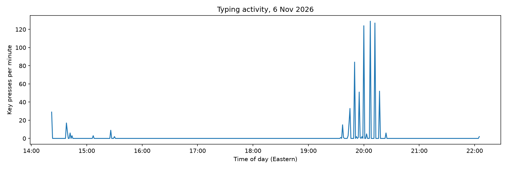

# Ghost-in-the-Machine
A project to detect user stress and respond in the background
The keystrokes detected will record timestamps and event types, never which key.
Mouse movements track x and y coordinates and timestamp every 20ms - SUBJECT TO CHANGE
Single-Instance lock protects from multiple usage
Key Presses will always outnumber key releases as no way to find duplicate presses

## First results

*Key presses per minute across a ~8-hour session (6 Nov 2026, Eastern time). Typing is
bursty: most of the day is idle, with a concentrated burst in the evening. Counts include
held-key auto-repeat, and this plot shows activity only, not stress.*
